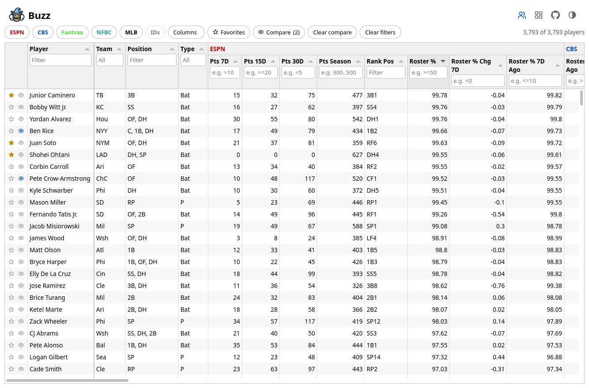
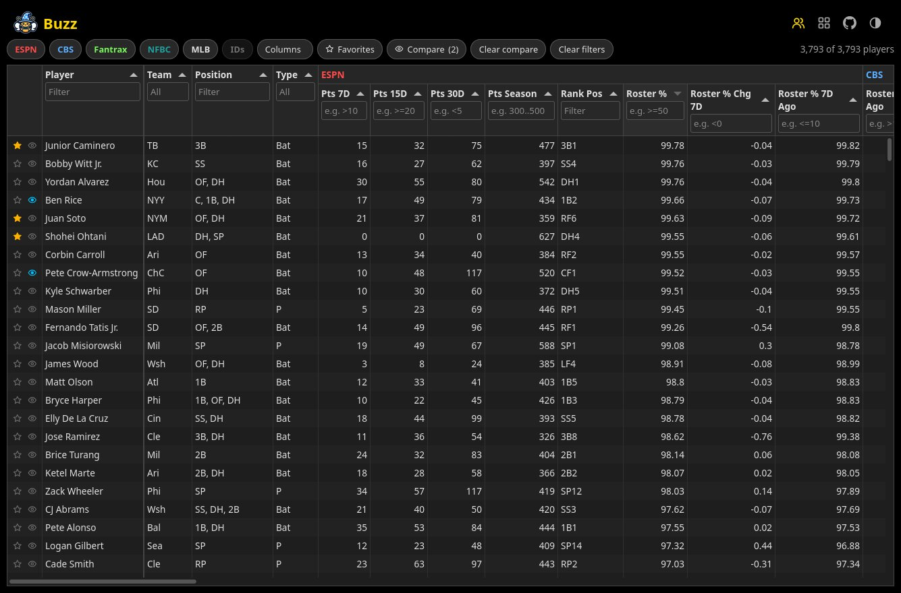
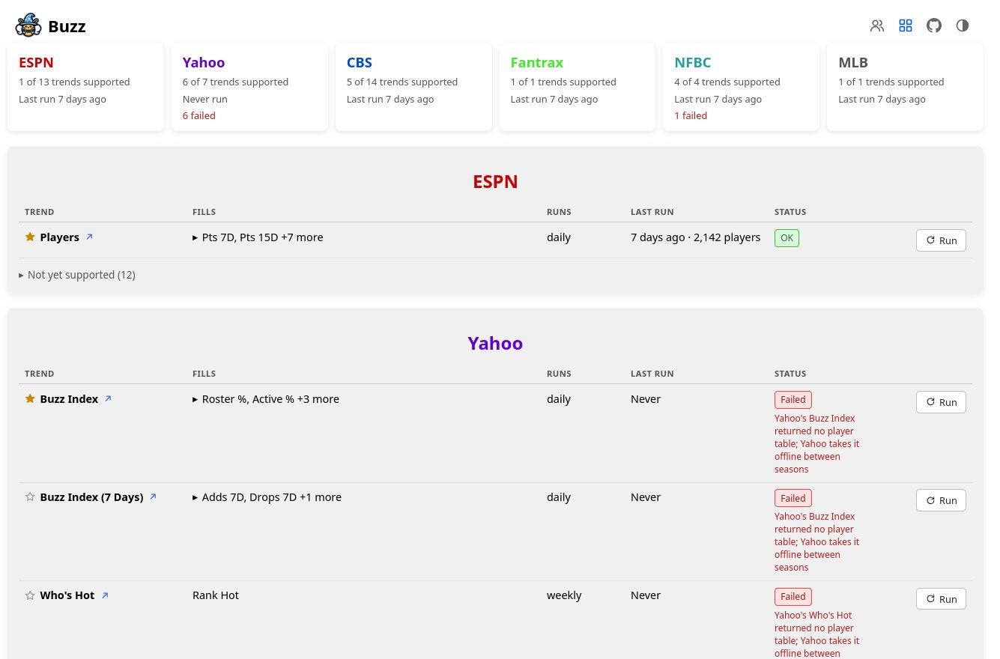
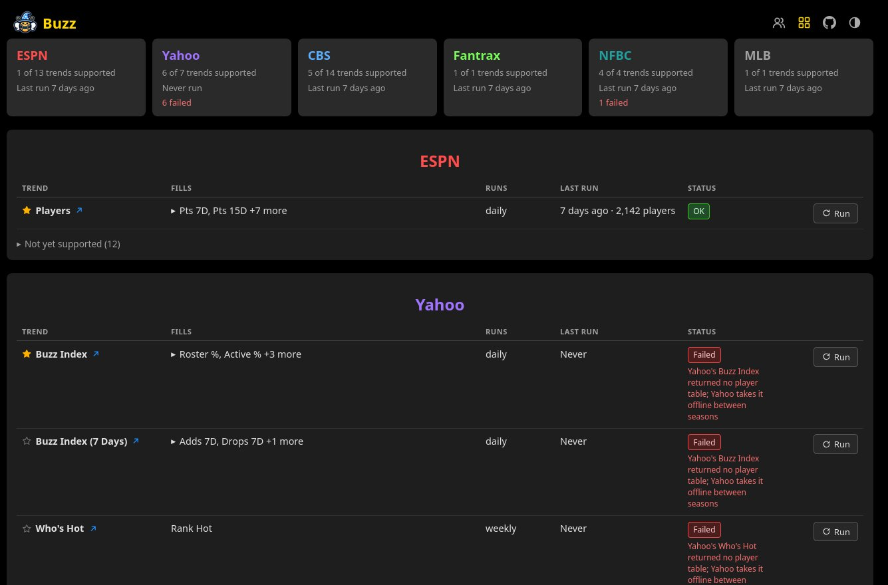
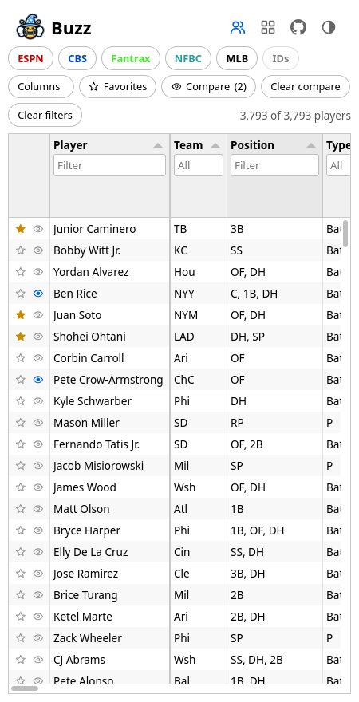
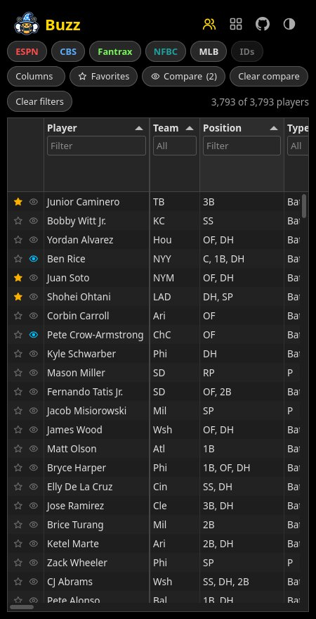
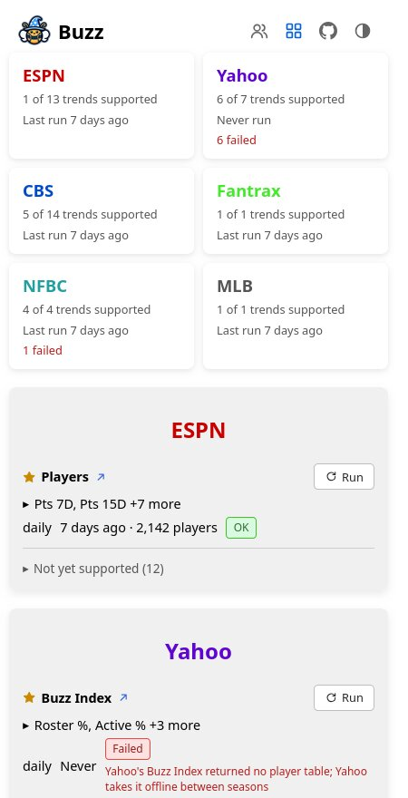

# Buzz

[](https://github.com/wazam/fantasy-baseball-buzz/actions/workflows/docker.yml)
[](https://github.com/wazam/fantasy-baseball-buzz/actions/workflows/compose-test.yml)
[](https://github.com/wazam/fantasy-baseball-buzz/actions/workflows/lint.yml)
[](https://github.com/wazam/fantasy-baseball-buzz/releases)
[](https://hub.docker.com/r/wazam123/fantasy-baseball-buzz)
[](https://hub.docker.com/r/wazam123/fantasy-baseball-buzz)
[](https://github.com/wazam/fantasy-baseball-buzz/pkgs/container/fantasy-baseball-buzz)

 **Buzz** is a self-hosted fantasy baseball dashboard that aggregates **MLB player trends**, rankings, projections, and social fantasy signals like **% rostered**, **adds/drops**, and **% started** from top platforms. It presents a unified, sortable, and filterable view of how players are valued across fantasy leagues, combining social signals with real-life performance metrics and rest-of-season projections.

Rather than forecasting player talent, Buzz reveals how the fantasy community is reacting, surfacing surging pickups, fading names, and platform-specific roster shifts. By tracking this behavior in near real time, you can act on emerging trends before your league does. Whether you're a data-driven GM or just playing the wire, Buzz delivers **fantasy market intelligence** with no third-party logins, no subscriptions, and no fluff.

## Table of Contents

- [Features](#features)
- [Tech Stack](#tech-stack)
- [Quick Start](#quick-start)
  - [Run via Docker Compose](#run-via-docker-compose)
  - [Build from Source](#build-from-source)
- [Environment Variables](#environment-variables)
- [Your Data](#your-data)
- [Screenshots](#screenshots)
- [Contributing](#contributing)
- [Disclaimers](#disclaimers)
- [License](#license)

---

## Features

- **Multi-Source Coverage**: Pulls fantasy player data from ESPN, Yahoo, CBS, Fantrax, and NFBC, and MLB IDs and player bios from MLB.
- **Unified Player Dashboard**: See every eligible MLB player in a sortable, filterable table with side-by-side comparisons across platforms.
- **Fantasy Sentiment Tracking**: Focuses on social signals like ownership trends and transaction volume to reveal shifts in player value before your league reacts.
- **Fantasy Valuation Metrics**: Covers projection-based, statistic-based, and opinion-based rankings for various timeframes including preseason, weekly, and rest-of-season to give a complete picture of a player's value.
- **Manual Data Refresh**: Trigger scrapes manually to pull the most up-to-date data directly from each platform with no stale caches or outdated snapshots.
- **Fully Self-Hosted**: Runs entirely on your own machine with no third-party accounts, logins, or subscriptions required.
- **Responsive Design**: Clean UI optimized for desktop and mobile use.
- **One-Command Docker Launch**: Start Buzz with a single Docker Compose command, with no database to set up.

## Tech Stack

- **Language and Runtime**: Python, powered by Flask for the web app served by Gunicorn, Requests for HTTP, and BeautifulSoup for scraping, managed with Pipenv.
- **Frontend and Templating**: Jinja2 for dynamic HTML, styled with responsive CSS for mobile and desktop support.
- **Database Layer**: SQLite, a single file in the data folder, shown in a sortable, filterable players table built with Tabulator.
- **Infrastructure and Deployment**: Containerized with Docker and run with Docker Compose, locally or on a server.
- **Automation and CI/CD**: GitHub Actions for testing, building, and publishing Docker images automatically.

## Quick Start

> [!TIP]
> Run via Docker Compose is recommended for most users.

### Run via Docker Compose

> [!NOTE]
> Images are published to [GHCR](https://github.com/wazam/fantasy-baseball-buzz/pkgs/container/fantasy-baseball-buzz) (`ghcr.io/wazam/fantasy-baseball-buzz`) and [Docker Hub](https://hub.docker.com/r/wazam123/fantasy-baseball-buzz) (`wazam123/fantasy-baseball-buzz`). The compose files use GHCR by default.

1. **Create `compose.yaml`**

    ```yaml
    services:
      buzz:
        image: ghcr.io/wazam/fantasy-baseball-buzz:latest
        container_name: buzz
        restart: unless-stopped
        user: "1000:1000"
        environment:
          - FANTRAX_LEAGUE_ID=${FANTRAX_LEAGUE_ID:-}  # optional
          - TZ=${TZ:-UTC}  # optional
          - FORWARDED_ALLOW_IPS=${FORWARDED_ALLOW_IPS:-127.0.0.1,::1}  # optional
        volumes:
          - ./data:/usr/src/data
        ports:
          - "9108:9108"
    ```

2. **Optionally, create `.env` next to `compose.yaml`**

    Every setting is optional. To change any of the [Environment Variables](#environment-variables), add it to a `.env` file next to `compose.yaml`, one `NAME=value` per line, such as `TZ=America/New_York`.

3. **Create the data folder and launch Buzz**

    ```sh
    mkdir -p data
    docker compose up -d
    ```

    `data` holds the players database and scrape results, and must exist before the first run, owned by the user in `user:` (`1000:1000` by default, run `id` to see yours). Otherwise Docker creates it as root and Buzz cannot write to it. If you change `user:` later, or the folder already has another owner, hand it over with `sudo chown -R <uid>:<gid> data`. Buzz checks this when it starts, and if it can't write to `data`, it stops and logs the command to run.

4. **Fill the players table**

    Open the Index page at [http://localhost:9108/index](http://localhost:9108/index) and select **Run** on a trend. Its results appear on the Players page at [http://localhost:9108/](http://localhost:9108/). Start with ESPN's **Players** trend, which adds every player along with their team and position.

### Build from Source

1. **Clone the repository**

    ```sh
    git clone https://github.com/wazam/fantasy-baseball-buzz.git
    cd fantasy-baseball-buzz
    ```

2. **Optionally, create `.env` to change any settings**

    Add the settings you want to change to a `.env` file in the repo folder, one `NAME=value` per line, as in [Run via Docker Compose](#run-via-docker-compose).

3. **Build the image and launch Buzz**

    `compose.override.yaml` is applied automatically. It builds a local `fantasy-baseball-buzz:local` image in place of the published one.

    ```sh
    mkdir -p data
    docker compose up -d --build
    ```

    `data` holds the players database and scrape results, and must exist before the first run, owned by the user in `user:` (`1000:1000` by default, run `id` to see yours). Otherwise Docker creates it as root and Buzz cannot write to it. If you change `user:` later, or the folder already has another owner, hand it over with `sudo chown -R <uid>:<gid> data`. Buzz checks this when it starts, and if it can't write to `data`, it stops and logs the command to run.

    For active development, also layer on `compose.dev.yaml`. It bind-mounts `src/`, `templates/`, and `static/`, and runs Flask's development server with `FLASK_DEBUG=1` in place of Gunicorn, so code and template changes reload without a rebuild. Passing any `-f` flag disables the automatic `compose.override.yaml` merge, so list it explicitly:

    ```sh
    docker compose -f compose.yaml -f compose.override.yaml -f compose.dev.yaml up -d --build
    ```

    > [!WARNING]
    > `FLASK_DEBUG=1` exposes the interactive Werkzeug debugger on port 9108. Use `compose.dev.yaml` only on a trusted local machine.

4. **Fill the players table** the same way as in [Run via Docker Compose](#run-via-docker-compose)

## Environment Variables

You can customize Buzz behavior using these optional environment variables: Buzz checks them when it starts: an empty value counts as not set, and a value it can't use stops the container with an error in `docker compose logs` that names the setting.

| Variable                | Description                                                                                                                                                                          | Default                                                                                                                          |
|-------------------------|--------------------------------------------------------------------------------------------------------------------------------------------------------------------------------------|----------------------------------------------------------------------------------------------------------------------------------|
| `FANTRAX_LEAGUE_ID`     | Your Fantrax league ID, the value after `/league/` in your league URL. Needed by the Fantrax trend, and must be a league from the current season, since Fantrax only serves stats for a league's own seasons.| *(not set)*                                                                                                                      |
| `TZ`                    | Time zone used for logs and results file names. Accepts any [tz database name](https://en.wikipedia.org/wiki/List_of_tz_database_time_zones#List). An unknown name logs a warning and uses UTC.                                                                                                                                      | `UTC`                                                                                                                            |
| `FORWARDED_ALLOW_IPS`   | Reverse proxy IPs to trust for `X-Forwarded-For` and `X-Forwarded-Proto` headers, comma-separated (CIDR ranges allowed). Behind a reverse proxy, set this to the proxy's address as the container sees it, so the access log shows real client IPs and redirects keep `https://`: the proxy container's address on a shared Docker network, or the network's gateway (from `docker network inspect`) when the proxy runs on the host. Use `*` only if nothing but the proxy can reach port 9108.| `127.0.0.1,::1`                                                                                                                  |

> [!TIP]
> Other devices on your network can reach Buzz at `http://<host-ip>:9108`, where `<host-ip>` is the address of the machine running Docker.
>
> If a reverse proxy runs on the same machine, publish the port on loopback only (`"127.0.0.1:9108:9108"` under `ports:`), so other devices can't go around the proxy.
>
> Do not put this on the Internet if you do not know what you are doing.

The `buzz` image includes a built-in health check against `/index`.

## Your Data

Everything Buzz keeps is in the `data` folder:

- `buzz.db`: the players table, a SQLite database. Buzz creates it on first start and adds a column for each new trend label.
- `results/`: each scrape's raw results as JSON, plus `runs.jsonl`, the history of every run.
- `trend-favorites.json`: trends you've made favorites, or taken off, on the Index page.
- `player-lists.json`: the players on your Favorites and Compare lists from the Players page, saved by their MLB ID, or another source's ID when there's no MLB ID, so the lists survive starting over below.

To back up, copy the `data` folder while Buzz is stopped.

To start over with an empty players table and import your saved results again, oldest first:

```sh
docker compose stop buzz
rm data/buzz.db*
docker compose start buzz
docker exec buzz ./.venv/bin/python src/db.py import
```

To import only some results, list them after `import`, for example this season's:

```sh
docker exec buzz sh -c './.venv/bin/python src/db.py import data/results/2026-*.json'
```

Buzz matches each player a source sends to a row by the source's ID, then by name, ignoring accents, case, periods, hyphens, and suffixes like `Jr.`, so `C.J. Abrams` and `CJ Abrams` are one player. When a name fits more than one row, the row that best matches the player's team, type (batter or pitcher), and position wins, with ESPN's row ahead when the rest is equal. If no row wins outright, Buzz adds a new row instead of guessing. A row whose team and type both differ is never a match, since that's a batter and a pitcher who share a name. Rows can still be split, for example when a team gone stale in an old result points to the wrong namesake. To list every name on more than one row, with each row's Id, team, position, and source IDs (once MLB's players trend has run, the row with an MLB ID is the major leaguer, and the others are usually minor leaguers who share the name):

```sh
docker exec buzz ./.venv/bin/python src/db.py duplicates
```

To merge two rows that are the same player, give the Id of the row to keep, then the Id of the row to delete. Without `--yes` it only shows what it would copy and delete:

```sh
docker exec buzz ./.venv/bin/python src/db.py merge 986 7
docker exec buzz ./.venv/bin/python src/db.py merge 986 7 --yes
```

The kept row gets every field it's missing from the deleted row, its source IDs included, so later imports update the kept row and it stays on any Favorites or Compare list the deleted row was on. Buzz won't merge two rows holding different IDs from the same source, since those are different players. Merge while no trend is running, and back up the `data` folder first.

## Screenshots



The Players page in light mode: every player in one sortable, filterable table, with each source's columns grouped under its name. The buttons above the table show or hide each source's columns and the IDs, hide single columns from the Columns menu, filter to your Favorites or Compare players, and clear every filter. Select a star to add a player to Favorites, or the eye to add them to Compare; **Clear compare** empties Compare for a new week.



The same Players page in dark mode, the default theme.



The Index page in light mode, with a summary tile per source Buzz can scrape and a table of each source's supported trends showing the columns they fill, how often they run, their last run, their status, and a Run button. Trends not yet supported are listed below each table, and further down, sources planned for later list theirs.



The Index page in dark mode.



The Players page on a phone in light mode, where the table scrolls sideways to reach each source's columns.



The Players page on a phone in dark mode.



The Index page on a phone in light mode, with the source tiles in two columns and each trend stacked into its name, the columns it fills, and its run details.

## Contributing

Report bugs or feature requests by opening an issue on the [GitHub repository](https://github.com/wazam/fantasy-baseball-buzz/issues). See [CHANGELOG.md](CHANGELOG.md) for what changed in each release, [ROADMAP.md](ROADMAP.md) for planned and proposed features, and [RELEASING.md](RELEASING.md) for how a release is made.

## Disclaimers

- [ESPN Terms of Use](https://disneytermsofuse.com/english/)
- [Yahoo Terms of Service](https://legal.yahoo.com/us/en/yahoo/terms/otos/index.html)
- [CBS Terms of Use](https://www.viacomcbs.legal/us/en/cbsi/terms-of-use)
- [Fantrax Terms of Service](https://www.fantrax.com/terms-of-service)
- [NFBC Terms of Service](https://terms.shgn.com/terms?theme=nfc)
- [MLB Terms of Use](https://www.mlb.com/official-information/terms-of-use)
- [MLB Stats API Copyright Notice](https://gdx.mlb.com/components/copyright.txt)

## License

This project is licensed under the [MIT License](LICENSE).
